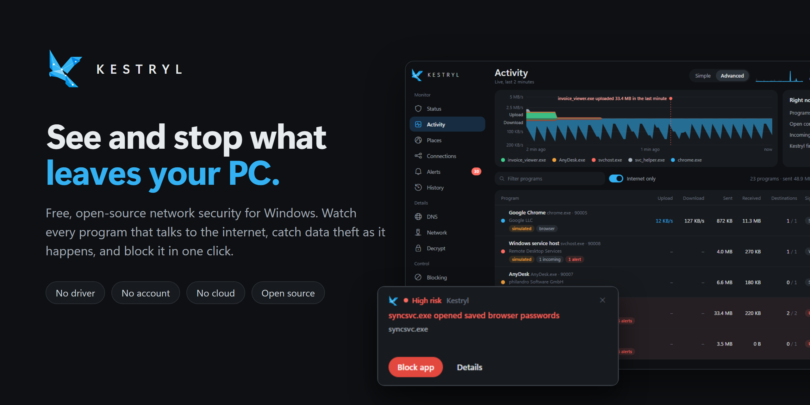
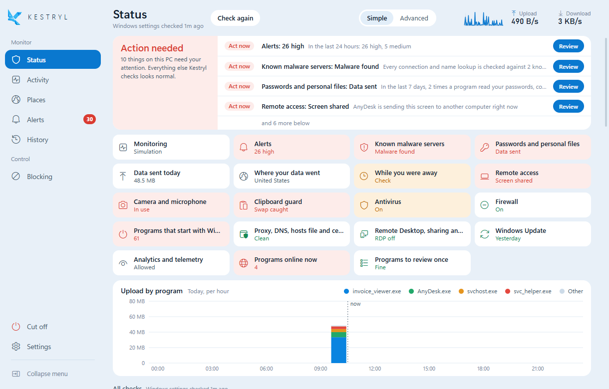
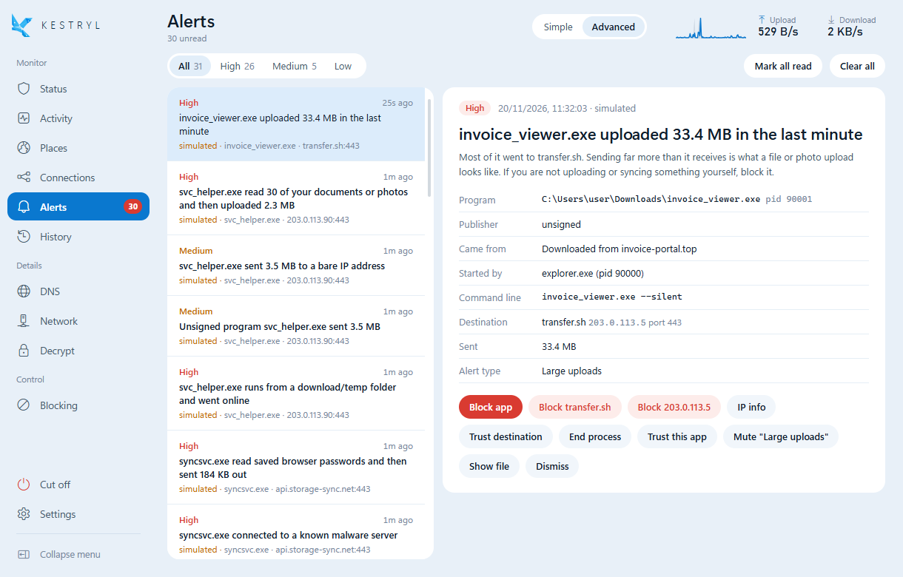
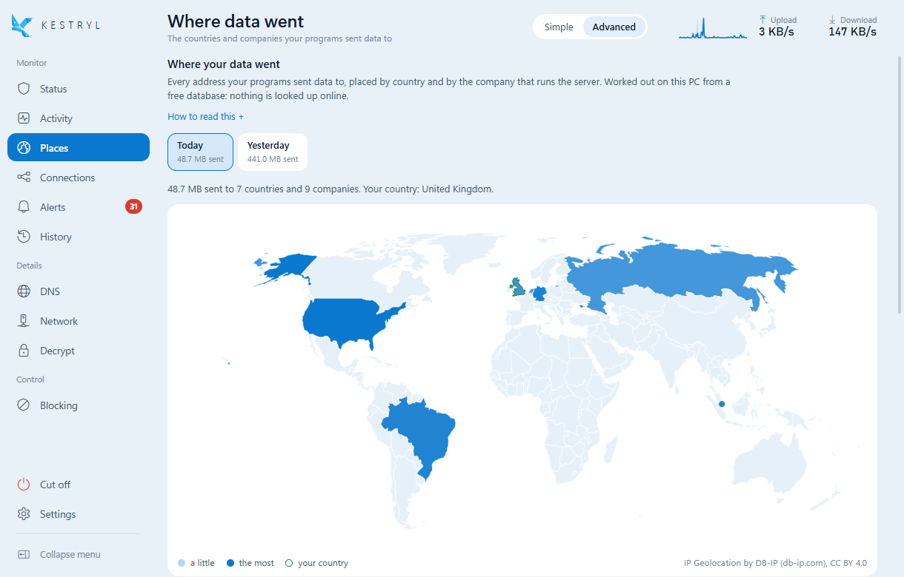
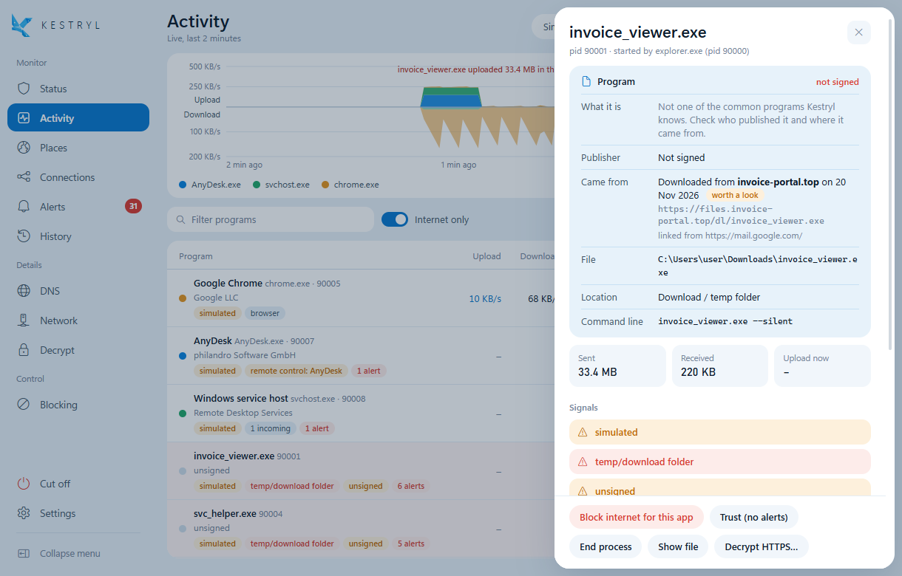

<p align="center">
  
</p>

<p align="center">
  <a href="https://github.com/HacanAle/Kestryl/releases/latest"></a>
  <a href="https://github.com/HacanAle/Kestryl/releases"></a>
  <a href="LICENSE"></a>
  
  
  <a href="https://github.com/HacanAle/Kestryl/actions/workflows/ci.yml"></a>
</p>

<p align="center">
  <b><a href="https://github.com/HacanAle/Kestryl/releases/latest">Download</a></b> ·
  <a href="docs/INSTALL.md">Install guide</a> ·
  <a href="docs/USER_GUIDE.md">User guide</a> ·
  <a href="SECURITY.md">Security</a> ·
  <a href="PRIVACY.md">Privacy</a> ·
  <a href="docs/HOW_IT_WORKS.md">How it works</a>
</p>

---

Your PC talks to the internet all day: browsers, updaters, chat apps, games, Windows itself. Almost none of it is visible. A password stealer looks exactly the same from the outside: a quiet program sending a few hundred kilobytes to a server you have never heard of.

**Kestryl makes that traffic visible.** It shows every program that sends or receives data, how much it sends and where it goes, and it raises an alert when a program behaves like data theft, remote control or tampering. One click blocks it.

It is free and open source, and runs entirely on your PC. You don't need an account, there's no cloud, and it installs no driver.

<table>
  <tr>
    <td width="50%"><br><sub><b>Status.</b> One verdict for the whole PC, in plain words.</sub></td>
    <td width="50%"><br><sub><b>Alerts.</b> What happened, why it matters, and buttons to act.</sub></td>
  </tr>
  <tr>
    <td width="50%"><br><sub><b>Places.</b> The countries and companies your data went to.</sub></td>
    <td width="50%"><br><sub><b>Program details.</b> Who made it, where it came from, what it did.</sub></td>
  </tr>
</table>

<sub>All screenshots come from Kestryl's built-in demo (<code>Kestryl.exe --simulate</code>). The "malicious" programs in them are made up.</sub>

## Why Kestryl

| | |
|---|---|
| 🛰️ **Every program, every byte, every destination** | A live view of each program's upload and download, with the site, country and company it talks to. Windows parts are named in plain words ("Windows Update", not `svchost.exe -k netsvcs`). |
| 🕵️ **Catches data theft as it happens** | Kestryl ties *file access* to *uploads*. A program that opens your saved browser passwords, crypto wallets or 30 of your documents and then sends data out raises a high alert within seconds. |
| ⛔ **One-click blocking** | Block an app, an IP, a whole site or an incoming port. Blocks are ordinary Windows Firewall rules, so they keep working when Kestryl is closed. |
| 🛡️ **A health check for Windows itself** | Defender, firewall, root certificates, proxy, hosts file, DNS, Remote Desktop, shared folders, and every place malware hides to start with Windows (Run keys, tasks, services, WMI, IFEO, the Sticky Keys backdoor). Anything new is reported. |
| 🌍 **Where your data went** | A world map of each day's uploads by country and company, worked out on your PC from a free offline database. Nothing is looked up online. |
| 🌙 **While you were away** | When the screen is locked or nobody uses the PC, Kestryl writes down everything that is sent and shows you a report when you're back. |
| 📋 **Clipboard guard** | Catches "clipper" malware that swaps a copied crypto wallet address or IBAN for the attacker's own. |
| 🎥 **Camera and microphone watch** | Shows which program uses them right now, from Windows' own record, and alerts on unexpected ones. |
| ☠️ **Known malware servers** | Every connection and DNS lookup is checked against free threat lists (abuse.ch, C2IntelFeeds, Spamhaus DROP, Emerging Threats). |
| 🔬 **Look inside when you need to** | *Peek* captures one connection for a few seconds and shows whether it is really encrypted and where it really goes. *Decrypt* (password-protected, time-limited) shows what one chosen program sends inside HTTPS. |
| 👓 **Simple or Advanced** | *Simple* speaks plain words for everyone. *Advanced* adds IPs, ports, PIDs, DNS, command lines and hashes for IT people. Kestryl (the default), Dark, Light and Follow-Windows themes. |

## Built to be trusted

A security tool has full access to your PC, so you shouldn't have to take it on faith. Everything below can be checked.

- **Open source, GPL-3.0.** Every line is in this repository. Forks must stay open source too.
- **Built in public.** Release files are built by [GitHub Actions](.github/workflows/release.yml) from the tagged source, not on someone's PC. Each release lists SHA-256 checksums and carries a signed [build provenance attestation](docs/INSTALL.md#verify-your-download) that ties every file to the exact commit and workflow run.
- **No account, no telemetry, no ads, no cloud.** Kestryl contacts a short, fixed list of servers. [PRIVACY.md](PRIVACY.md) lists each one, why, and what is sent.
- **Your data stays on your PC.** History, alerts and settings live in `%LOCALAPPDATA%\Kestryl`. HTTPS decryption recordings are kept in memory only.
- **No driver, nothing hidden.** It uses tools Windows already has: kernel event tracing (ETW), Windows Firewall, Packet Monitor and Microsoft Defender. Every block it makes appears in `wf.msc` under the group *Kestryl*.
- **It never deletes or quarantines anything.** It reports and asks. Blocking, ending a process or decrypting always takes a click from you.
- **Security-audited before release.** v1.7.9 went through a full review of its privileged code paths. The issues found were fixed and are covered by tests. See [SECURITY.md](SECURITY.md#audit-of-v179).
- **Honest about its limits.** It is not an antivirus (keep Microsoft Defender on), and the download is not yet code-signed. [Why Windows warns, and how to check the file](docs/INSTALL.md#windows-protected-your-pc).

## Download

| File | For |
|---|---|
| **`Kestryl_1.8.3_x64-setup.exe`** | Most people. Installs to *Program Files* (recommended: only administrators can change it there), adds a Start menu entry and an uninstaller. |
| `Kestryl_1.8.3_x64_portable.exe` | No install. Run it from a folder of your choice, for example a USB stick or for a quick look. |
| `SHA256SUMS.txt` | Checksums of both, to verify your download. |
| Source code (zip / tar.gz) | Added by GitHub to every release. Build it yourself with [docs/BUILDING.md](docs/BUILDING.md). |

All of these are on the [latest release](https://github.com/HacanAle/Kestryl/releases/latest) page. Requirements: Windows 10 (version 2004 or later) or Windows 11, 64-bit, and administrator rights for full monitoring. Step-by-step help: **[Install guide](docs/INSTALL.md)**.

## Quick start

1. **Install** with the setup file, then start Kestryl from the Start menu. Windows asks for administrator rights. Say yes, because Kestryl needs them to see byte counts, DNS names and file access, and to block.
2. **Open Status.** It checks Windows' security settings and gives one verdict: *No signs of trouble*, *Worth a look* or *Act now*. Each line explains itself; press **Review** to jump to the details.
3. **Watch Activity** for a minute. Every program using the network appears with what it sends and receives. Click one to see who made it and where it came from.
4. **When an alert pops up** in the bottom-right corner, read the reason, then choose: **Block app**, **Details**, **Trust** (if it's yours) or **Dismiss**.
5. **Settings → Start with Windows** keeps Kestryl watching from the moment you sign in, without a UAC prompt each time.

Closing the window keeps Kestryl in the tray, and it keeps watching. Quit it from the tray icon. The **[User guide](docs/USER_GUIDE.md)** explains every page, alert and button.

## What raises an alert

A few examples. The [full list](docs/USER_GUIDE.md#what-raises-an-alert) has more than 25 rules.

| Behaviour | Example |
|---|---|
| Passwords read, then data sent | A program that isn't your browser opens Chrome's saved passwords, then uploads 180 KB |
| Documents collected, then uploaded | 20+ documents or photos opened within minutes, then 2 MB+ sent out |
| Known malware server | A connection or DNS lookup matches a botnet or Cobalt Strike control server |
| Screen sharing / remote control | AnyDesk, TeamViewer, RustDesk and others streaming your screen (scammers use the real, signed tools) |
| Stealer-style uploads | Unsigned program sending to Telegram bots, Discord webhooks, paste sites or file droppers |
| Beaconing and DNS tunnelling | Steady check-ins every N seconds; dozens of random subdomains of one domain |
| Windows tools going online | `mshta`, `rundll32`, `certutil`, `bitsadmin` and hidden PowerShell |
| Backdoors and tampering | New startup entry, root certificate, proxy, Defender exclusion; Kestryl's own tracing stopped |
| Clipboard swap | A copied wallet address or IBAN replaced within 3 seconds |

Severity follows the program: the same behaviour is *low* from a signed app in Program Files and *high* from an unsigned file in your Downloads folder.

## FAQ

<details>
<summary><b>Is Kestryl safe to install?</b></summary>

All of it is open for anyone to read, the downloads are built by GitHub from that code, and you can check every file against its checksum and build attestation ([how](docs/INSTALL.md#verify-your-download)). It sends nothing about you anywhere ([PRIVACY.md](PRIVACY.md)). It never deletes files, and every change it makes to Windows (firewall rules, the start-up task, analytics switches) can be undone from inside the app.
</details>

<details>
<summary><b>Why does it need administrator rights?</b></summary>

Windows only shows per-program byte counts, DNS names, file access and incoming connections to administrators, and only administrators can add firewall rules. Without admin rights Kestryl runs in *limited mode*: it can still list which programs hold connections, but it can't see how much they send and can't block.
</details>

<details>
<summary><b>Windows says "Windows protected your PC". Why?</b></summary>

The download is not signed with a paid code-signing certificate yet, and SmartScreen warns about any new file that hasn't built up a reputation. Click **More info → Run anyway**, after you've [checked the checksum](docs/INSTALL.md#verify-your-download) if you like.
</details>

<details>
<summary><b>Does it replace my antivirus?</b></summary>

No. Kestryl watches *behaviour* on the network and around your sensitive files, and asks the Microsoft Defender already on your PC for a second opinion on unsigned programs. Keep Defender (or your antivirus) on. The two work well together.
</details>

<details>
<summary><b>Will it slow my PC down?</b></summary>

It reads events Windows already produces and updates its window once a second. The heavier checks (the security check, signature checks, Defender scans of new unsigned programs) run in the background at low frequency.
</details>

<details>
<summary><b>Can it see inside encrypted (HTTPS) traffic?</b></summary>

Not by itself: almost everything is encrypted, and Kestryl judges behaviour instead (who sends, how much, where, how often, after opening which files). For the rare case where you must see inside, the *Decrypt* page opens one chosen program's HTTPS for a few minutes. It needs administrator rights and your own decryption password, shows a red banner the whole time, and cleans up after itself. [Details](docs/USER_GUIDE.md#https-decryption).
</details>

<details>
<summary><b>How do I uninstall it completely?</b></summary>

First undo what you set up inside Kestryl (*Start with Windows*, your blocks, the analytics switches), then uninstall from *Settings → Apps*. Uninstalling alone leaves those firewall rules and settings in Windows. The [clean-uninstall steps](docs/INSTALL.md#uninstall) have PowerShell lines for each.
</details>

## Build from source

```powershell
git clone https://github.com/HacanAle/Kestryl.git
cd Kestryl
npm install
npx tauri build            # setup in src-tauri\target\release\bundle\nsis, exe in src-tauri\target\release
```

You need Rust (MSVC), Node.js and the Visual Studio C++ build tools. Tests, the demo mode, and signing your own build are covered in **[docs/BUILDING.md](docs/BUILDING.md)**.

## Make it your own

Kestryl is GPL-3.0: fork it, change it, ship your own version, as long as your version stays open source under the same license. The rules are plain data in [`ui/rules.json`](ui/rules.json) and [`src-tauri/src/detect.rs`](src-tauri/src/detect.rs), the plain-words program library is [`ui/programs.js`](ui/programs.js), and the look is one stylesheet, [`ui/app.css`](ui/app.css). Start with [How it works](docs/HOW_IT_WORKS.md) and [CONTRIBUTING.md](CONTRIBUTING.md). Pull requests are welcome.

## Security

Found a vulnerability? Please report it privately through **[GitHub's private vulnerability reporting](https://github.com/HacanAle/Kestryl/security/advisories/new)**, not in a public issue. See [SECURITY.md](SECURITY.md).

## Credits

- Built with [Tauri](https://tauri.app) and Rust. Window by Microsoft WebView2.
- IP geolocation by [DB-IP](https://db-ip.com), licensed under [CC BY 4.0](https://creativecommons.org/licenses/by/4.0/).
- Country outlines from [Natural Earth](https://www.naturalearthdata.com) (public domain), via [world-atlas](https://github.com/topojson/world-atlas).
- Threat lists from [abuse.ch](https://abuse.ch) (Feodo Tracker, ThreatFox), [C2IntelFeeds](https://github.com/drb-ra/C2IntelFeeds), [Spamhaus DROP](https://www.spamhaus.org/drop/) and [Emerging Threats](https://rules.emergingthreats.net).
- IP details on request from [ipinfo.io](https://ipinfo.io) and [rdap.org](https://rdap.org).

## Support

Kestryl is free and open source, with no ads and no account. If it's useful to you, you can buy me a coffee on [Ko-fi](https://ko-fi.com/N5G22AX1Z7).

<a href='https://ko-fi.com/N5G22AX1Z7' target='_blank'></a>

## License

[GNU General Public License v3.0](LICENSE). Kestryl comes with no warranty; see the license for details.
