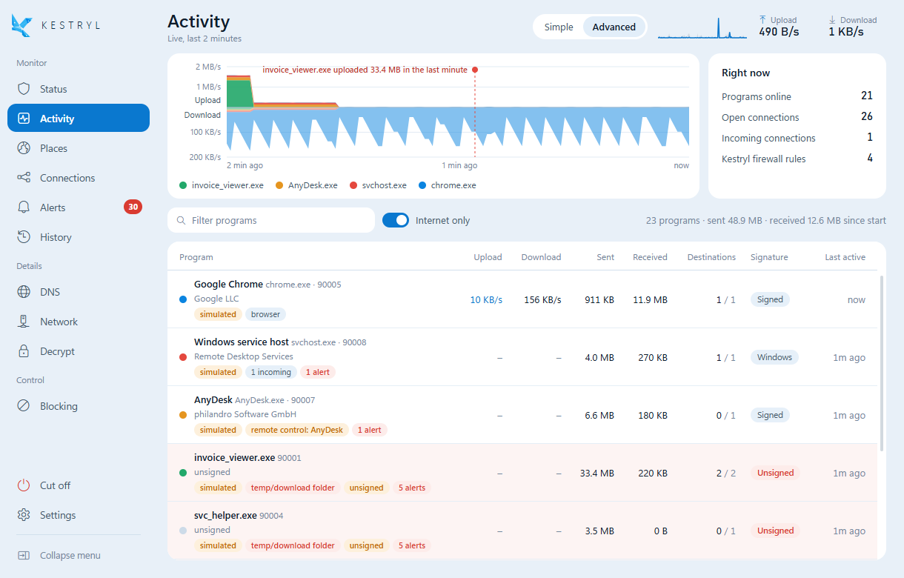
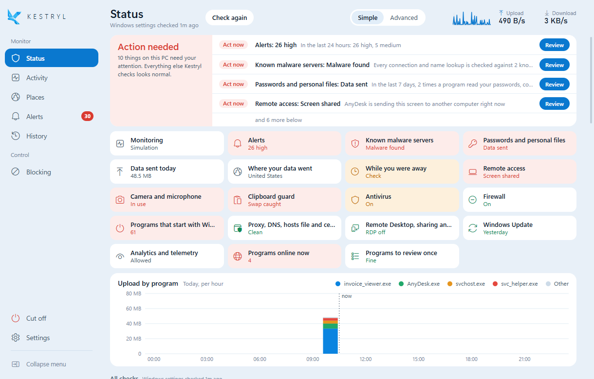
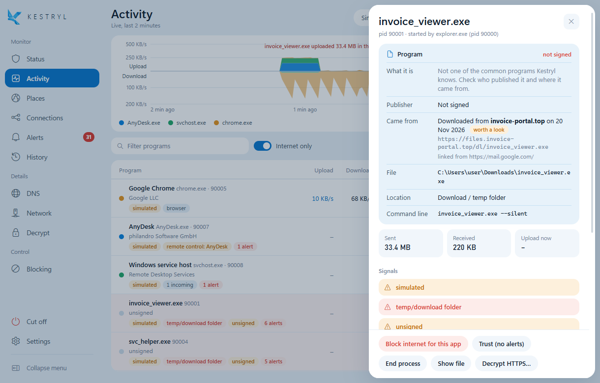
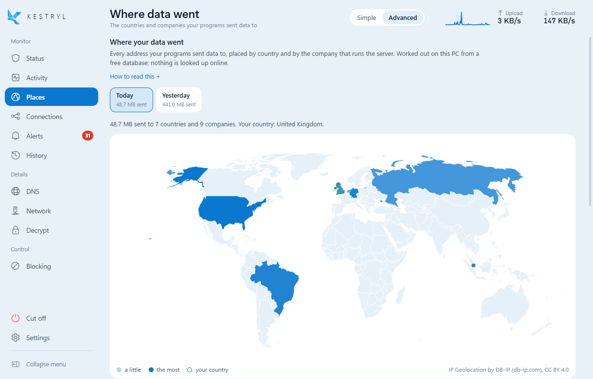
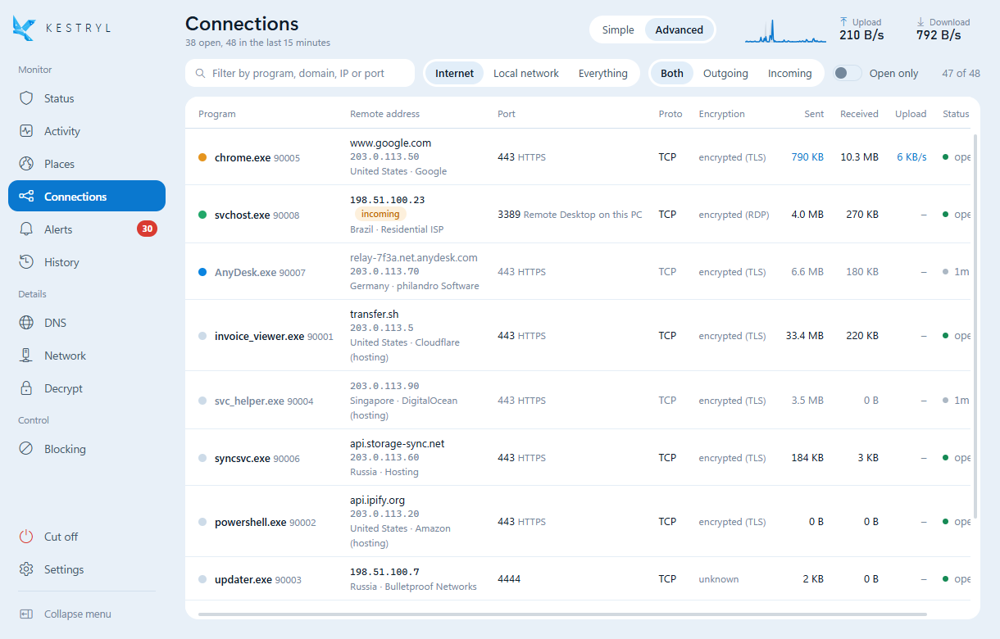
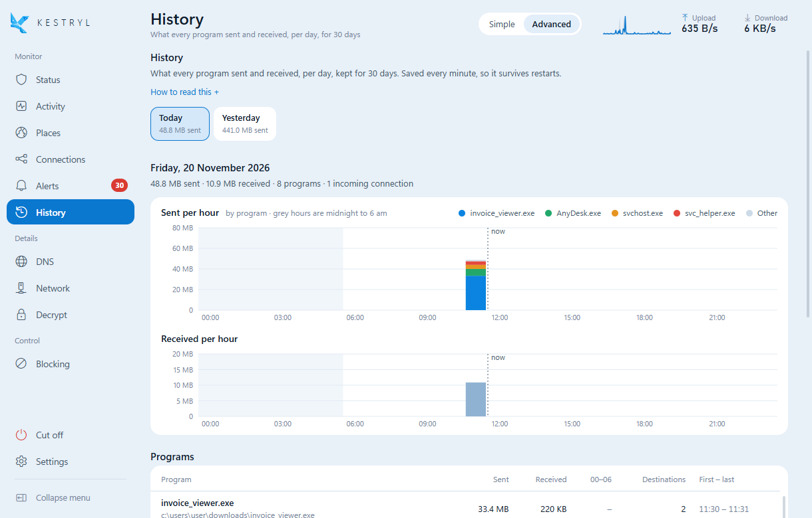
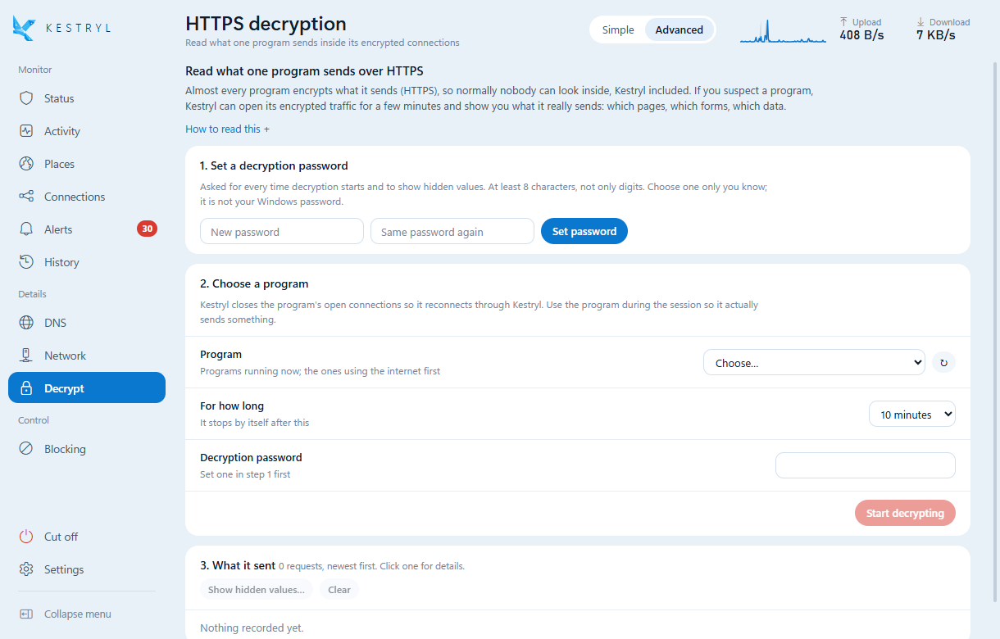

# Kestryl user guide

Kestryl answers one question: *is this PC in safe hands?* This guide walks through every page, what each alert means, and what each button does.

- [The window](#the-window)
- [Simple and Advanced view](#simple-and-advanced-view)
- [Status](#status)
- [Activity](#activity)
- [Places](#places)
- [Connections](#connections)
- [Alerts](#alerts)
- [History](#history)
- [DNS lookups](#dns-lookups)
- [Network](#network)
- [Peek](#peek)
- [IP info](#ip-info)
- [Blocking](#blocking)
- [Analytics and telemetry](#analytics-and-telemetry)
- [HTTPS decryption](#https-decryption)
- [Trusting programs and destinations](#trusting-programs-and-destinations)
- [What raises an alert](#what-raises-an-alert)
- [Settings](#settings)
- [Where Kestryl keeps its data](#where-kestryl-keeps-its-data)
- [What Kestryl can't do](#what-kestryl-cant-do)

## The window

- **Menu** on the left: *Monitor* (Status, Activity, Places, Connections, Alerts, History), *Details* (DNS, Network, Decrypt; Advanced view only) and *Control* (Blocking). **Cut off** and **Settings** are at the bottom. **Collapse menu** shrinks it to icons.
- **Header**: page title, the **Simple / Advanced** switch, and live upload and download speed for the whole PC.
- **Pop-ups**: medium and high alerts appear in the bottom-right corner of the screen, even when the window is closed, with **Block app** and **Details** buttons. Repeats are grouped, and a flood guard keeps it to a few per minute.
- **Tray icon**: closing the window keeps Kestryl watching. Click the tray icon to open it; right-click to quit.

Run as administrator for full monitoring. Otherwise the header shows **Limited mode** (only TCP connections are visible, with no byte counts, DNS names, file access or blocking).

## Simple and Advanced view

The switch in the header is remembered.

- **Simple** (default) speaks plain words for people who aren't in IT: program names like *Microsoft Edge* instead of `msedge.exe`, countries and companies instead of IP addresses. Connections, DNS, Network and Decrypt are hidden, as are process IDs, ports, IPs, command lines and hashes.
- **Advanced** shows everything.

## Status

One verdict for the whole PC: **No signs of trouble**, **Worth a look** or **Act now**, with the items that need attention first. Below is a tile and a detailed row for every check, each in plain words with details for IT people:

| Check | What it looks at |
|---|---|
| Monitoring | Tracing sessions alive, events Windows dropped, file monitoring running |
| Alerts | Alerts of the last 24 hours, by severity |
| Known malware servers | How many listed servers every connection is checked against, any contact in the last 7 days, and what Microsoft Defender said about unsigned programs Kestryl asked it to scan |
| Passwords and personal files | Programs that opened browser passwords, cookies, wallets, keys or documents, and whether they sent data afterwards |
| Data sent today | Top senders, and what left between midnight and 6 am |
| Where your data went | The countries and companies today's data went to |
| While you were away | Reports of what was sent while the screen was locked or the PC idle (see below) |
| Remote access | Remote-control tools running or streaming the screen; devices connected to this PC |
| Camera and microphone | What uses them now, and what did in the last 30 days, from Windows' own record |
| Clipboard guard | Whether it is on, and any swapped wallet or bank number of the last 7 days |
| Antivirus | Defender and other antivirus state, definition age, threats of the last 30 days, Defender exclusions |
| Firewall | Profiles on or off; Kestryl's blocks intact |
| Programs that start with Windows | Run keys, Startup folders, scheduled tasks (including odd ones hidden in Windows' own `\Microsoft\` task folder), auto-start services and drivers outside the Windows folder, WMI event subscriptions, Winlogon Shell/Userinit, IFEO "debugger" hooks, AppInit DLLs, and accessibility tools replaced by another program (the Sticky Keys backdoor). Each entry shows its signature; risky ones are flagged. Version numbers in paths are ignored, so an update isn't a "new" entry. Mark your own items with **Mark as mine**. |
| Proxy, DNS, hosts file and root certificates | Anything that redirects your traffic or could read it |
| Remote Desktop, sharing and UAC | Remote Desktop on or off, shared folders, UAC level |
| Windows Update | Date of the last installed update |
| Analytics and telemetry | How many analytics switches are on |
| Programs online now | Unsigned programs, or programs in temp folders, that are online right now |
| Programs to review once | Every program ever seen online that lives outside Windows and Program Files, with publisher and origin. Programs that were already there before Kestryl never count as "new", so this is where older malware would show up. |

The Windows checks run at start, every 15 minutes, and within a minute of a change to any start-up place. **Check again** runs them now. Below the checks: an **Upload by program** chart for today, per hour.

**While you were away.** When the screen locks, or nobody touches the keyboard or mouse for 10 minutes, Kestryl notes what every program sends until you are back. The 15 minutes before the lock are filled in too. Each report lists the programs, how much they sent and where to (site, country, company). If an unsigned program, one in a temp or download folder, or a Windows tool sends 512 KB or more in that time, the report is flagged and raises an alert. The last 30 reports are kept.

## Activity

Every program using the network, live.

- **The graph** shows upload (above the line) and download (below) per program for the last two minutes, one colour per busy program, with the newest alert marked.
- **Right now**: programs online, open connections, incoming connections, Kestryl's firewall rules.
- **The table**: upload and download speed, totals, number of destinations, publisher (Authenticode signature) and risk tags such as *opened passwords*, *remote control*, *N incoming*, *changed since trusted* and *look-alike name*. `svchost.exe` rows name the Windows services inside. **Internet only** hides local-network-only programs.

**Click a program** to open its details:

- **What it is**: a plain-words note for about 250 common programs and Windows parts, including whether uploading is normal for it.
- **Came from**: the site it was downloaded from and when, read from the note Windows attaches to downloads (*Mark of the Web*), or *Microsoft Store*, *part of Windows*, *installed in Program Files*. Downloads from chat-app attachments, file hosts, code sites, bare IPs and cheap domains are marked *worth a look*.
- Publisher, file path, location, command line, services, parent program, the sensitive files it opened.
- **Microsoft Defender**: scan just this file (report only; nothing is deleted or quarantined), with its SHA-256. **VirusTotal** opens the file's page in your browser; only the hash is sent, and only when you click.
- Every destination, with its country and company.
- Buttons: **Block internet for this app**, **Trust**, **End process**, **Show file**, and in Advanced view **Decrypt HTTPS…**.

*Look-alike name* means the program uses the name of a known program, but it's a Windows file outside the Windows folder, or it's unsigned, or it's signed by someone other than the real publisher.

## Places

A world map of where each day's data was sent, shaded by amount, with your own country outlined. Beside it are the countries and the companies running the servers, each with its sites and programs. Hosting companies (Amazon, Cloudflare, Akamai…) are marked, because their name says whose computer it is, not whose site.

The map shows where the **servers** are, not where the company is from. It works offline from DB-IP's free country and ASN database, downloaded once a month (about 12 MB). No address you talk to is ever sent anywhere to look it up. Pick any of the last 30 days. Your home country comes from Windows' region setting.

## Connections

*Advanced view.* Every program-to-address flow in both directions: domain (from DNS), IP, port and service, protocol, encryption guess, bytes each way, open or closed. Filter by **Internet / Local network / Everything** and **Outgoing / Incoming**. Click a row for **Block IP**, **Block site**, **IP info**, **Peek** and **Trust**.

## Alerts

The list is on the left; the selected alert's details are on the right: what happened, why it matters, the program, where it came from, the destination, the files involved, and one-click actions: **Block app**, **Block site / IP**, **IP info**, **Trust destination**, **End process**, **Trust this app**, **Mute** this kind of alert, **Show file**, **Dismiss** (or **Dismiss all N like this**).

Severity depends on the program. A signed app in Program Files gets *low*. The same behaviour from an unsigned program, a script host or a program in a temp folder gets *high*. Remote-control sessions are always high, because scammers use the real, signed tools. Repeats are grouped for 30 minutes.

**Kestryl never alerts about itself.** Its own process and the helpers it starts (PowerShell for signature and security checks, Defender scans, Packet Monitor, firewall changes) are registered by process ID as they are started. They never raise alerts and are tagged *Kestryl* in Activity. A program that merely *claims* Kestryl as its parent is not trusted, because a parent can be faked.

## History

One entry per day for 30 days, saved every minute so it survives restarts. Hourly sent and received charts with the night hours marked; every program with its destinations, bytes each way and night-time bytes; plus every connection other devices made to this PC.

## DNS lookups

*Advanced view.* Every name each program resolved, with the answers and failures. DNS names need full monitoring (administrator).

## Network

*Advanced view.*

- Adapters with live throughput, gateway and DNS servers.
- Devices on your network that recently talked to this PC (from the ARP table; no scan).
- **Listening ports**: the doors programs keep open, whether each can be closed, with **Show file**, **Block incoming** and **End**.
- **Who connected to this PC** in the last 15 minutes.

## Peek

A **Peek** button sits on connections and destinations (Advanced). It records that one connection for 10–40 seconds with Windows' own Packet Monitor (`pktmon`) and reports:

- for standard encryption (TLS, QUIC, SSH): the real server name and TLS version;
- for unencrypted traffic (HTTP, FTP, mail, DNS): the contents, with passwords, auth headers and cookies hidden;
- otherwise: whether the data looks random, meaning home-made encryption.

Nothing is decrypted, and the capture file is deleted right after.

## IP info

Operator, ASN, hostname and location from ipinfo.io, plus the registered owner, range and abuse contact via RDAP (rdap.org). Only the IP you look up is sent, only when you click, and results are cached for an hour. Private addresses (192.168.x.x, 10.x.x.x) are never looked up.

## Blocking

Every block is a Windows Firewall rule in the group **Kestryl**. Blocks keep working when Kestryl is closed and are visible in `wf.msc`. If one disappears without Kestryl removing it, Kestryl alerts.

| Block | What it does |
|---|---|
| **Block app** | Outbound block for that program file. Its open TCP connections are closed immediately. |
| **Block incoming** (Network → Listening ports) | Inbound block on that local port (for example `TCP 445`), so other devices can't connect. The program keeps running. |
| **Block IP / range** | No program can reach that address any more. |
| **Block site** | The site's addresses are blocked. Kestryl adds new addresses as DNS answers show up, while it's running. Big sites share servers (CDNs), so this can also block other sites. |
| **Script lockdown** | Blocks network access for PowerShell (5 and 7), wscript/cscript, mshta, certutil, bitsadmin, regsvr32, rundll32, hh, cmstp, WMIC, MSBuild, InstallUtil, RegAsm and RegSvcs (32- and 64-bit). Malware relies on these; normal people rarely need them online. |
| **Cut off internet** | Sets the firewall default for outgoing traffic to Block, for emergencies. **Restore internet** undoes it. Parts of Windows with their own allow rules can still connect. |

Remove any rule on the Blocking tab.

## Analytics and telemetry

Blocking tab → **Analytics and telemetry**. Each switch needs administrator rights and can be undone:

- **Windows diagnostic data**: the documented group policies (diagnostic data at the lowest level your edition allows, advertising ID, activity-history upload, app inventory, error-report uploads, feedback prompts, tailored experiences). It also disables the telemetry service (DiagTrack) and blocks it in Windows Firewall.
- **Microsoft Edge**, **Microsoft Office**, **Google Chrome**: their makers' published policies for diagnostics, usage reporting, feedback, and the shopping / "make searches better" uploads.
- **Known analytics servers**: firewall blocks, for every program, on server names that only collect usage data (Microsoft's `events.data.microsoft.com`, `vortex(-win).data.microsoft.com`, `telemetry.microsoft.com`, Edge/MSN `browser.events.data.msn.com`, Office `nexus.officeapps.live.com`, NVIDIA `events.gfe.nvidia.com`, Visual Studio `dc.services.visualstudio.com`).

Before changing anything, Kestryl records the old value of every registry entry, service start type and firewall rule it touches. Turning the switch off puts back exactly that, and only that. The hosts file is never used, because Defender treats a changed hosts file as a hijack. Nothing here stops Windows Update, Defender, the Store or signing in.

## HTTPS decryption

*Advanced view → **Decrypt**.*

Shows what **one** chosen program sends inside its encrypted connections: method, site, path, address parameters, headers, form fields and JSON or text bodies (gzip unpacked), plus the answer's status, type and size.

**How it works.** Kestryl makes a certificate authority for this session only and adds it to Windows' trusted roots. It then sets itself as Windows' proxy on 127.0.0.1. Connections from the chosen program get a certificate for the real site, made on the fly, but only after Kestryl has checked the real server's certificate itself. Every other program's traffic passes through untouched. The program's open connections are closed at the start, so it reconnects through Kestryl.

**Protection, so not just anyone can read your traffic:**

- **Administrator rights and a password.** The password is stored only as an Argon2id hash. Five wrong tries lock decryption for 10 minutes.
- **Every attempt is recorded as an alert**: right or wrong password, start, stop, password set or changed.
- **One program, at most 30 minutes.** It stops by itself. Kestryl itself is never decrypted.
- **Visible.** A red banner with the time left shows on every page, with a **Stop** button.
- **Leaves nothing behind.** The certificate's private key exists only in memory. When the session ends (Stop, time up, quit), the certificate is removed from Windows and your previous proxy setting is restored. After a crash, the next start cleans up.
- **Recordings stay in memory**, never on disk (at most 400 entries; **Clear** deletes them). Passwords, cookies, tokens and authorization headers are masked; showing them needs the password again.

**Limits.** Only programs that follow Windows' proxy setting are seen (browsers and most apps). HTTP/2 is turned down so the program falls back to HTTP/1.1. Programs that only trust their own server certificate (*certificate pinning*: some banking apps and updaters) refuse the connection; that is listed, and their later connections to that site pass through undecrypted. WebSockets and other upgraded connections are passed on unread.

## Trusting programs and destinations

- **Trusted programs** (Settings, or **Trust this app** on an alert or program) never alert, but their traffic is still shown. Trust follows the file: Kestryl records the publisher (unsigned programs: size and date). If the file is replaced or its signature changes, trust is suspended and you get an alert. Trust it again after a normal update.
- **Trusted IPs and domains** (**Trust** on a connection, **Trust destination** on an alert, **Trust this IP / Trust site** in IP info, or typed in Settings) never alert, and their traffic is **hidden** from Activity, Connections, DNS, History, totals and upload counting. Each has a **Show traffic** switch in Settings, off by default.
  - A domain covers its subdomains: trusting `google.com` covers `mail.google.com`. IPs and ranges (`142.250.0.0/15`) work too.
  - **Exception:** unsigned programs, programs in Temp or Downloads, scripts and Windows tools are never hidden or silenced by a trusted destination. A stealer uploading to a trusted Google Drive still shows up.

## What raises an alert

| Rule | Example |
|---|---|
| Known malware server | A program connects to, or looks up, an address on a threat list: "connected to a known malware server (C2IntelFeeds: possible Cobalt Strike C2 IP)". Control-server lists are high; criminal networks and attacking hosts medium. Also when another device connects in from one. |
| Microsoft Defender verdict, known malware file | Defender's scan of a new unsigned program finds a threat, or the file's SHA-256 is on ThreatFox |
| Camera or microphone switched on | A program that isn't a call, meeting or recording app starts using them: unsigned in a temp folder = high, unsigned = medium, signed = low; one step higher when it is also uploading |
| Password files read, then data sent | A program that isn't the browser opens Chrome's saved passwords or its password key, then sends 180 KB out |
| Programs opening passwords, cookies, wallets | Browser passwords, cookies and cards, Firefox logins, Windows Credential Manager, crypto wallets, Telegram/Discord/Steam logins, SSH/cloud/FTP keys, Outlook mailbox, password-manager vaults |
| Documents collected, then uploaded | A program opens 20+ of your documents or photos within minutes, then uploads 2 MB+ |
| Screen sharing / remote control | AnyDesk, TeamViewer, RustDesk, ScreenConnect, Quick Assist, VNC… streaming the screen (600 KB+ a minute) |
| Incoming connections | Remote Desktop / VNC / SSH / WinRM from the internet (high) or LAN (medium); file sharing reached from the internet; another device copying 50 MB+ from your shares; unknown programs accepting internet connections |
| Programs sending email or using FTP | A program that isn't a mail or FTP client talks SMTP (25/465/587) or FTP, which is how Agent Tesla-type stealers ship passwords |
| Upload to file-sharing / paste / bot sites | An unsigned app sends 3 MB to transfer.sh, pastebin, api.telegram.org, Discord webhooks |
| Large upload | One program uploads more than 20 MB to the internet within a minute (adjustable), sending far more than it receives |
| Public IP lookup | A non-browser asks api.ipify.org / ipinfo.io, a typical first step of stealers |
| Request catchers, tunnels, dynamic DNS | webhook.site, interact.sh, ngrok, trycloudflare, duckdns |
| Windows tools / script hosts online | mshta, rundll32, regsvr32, certutil, bitsadmin, wscript (high); PowerShell, curl (medium) |
| Suspicious ports | 4444 (Metasploit), IRC, Tor, mining pools, known RAT ports |
| Upload on a non-standard port | 5 MB+ out over an unknown protocol (custom or self-encrypted channel) |
| Program in Downloads / Temp / bare AppData going online | |
| Unsigned program sending data, or broken signature | |
| Data to a bare IP (no DNS lookup) | |
| Beaconing | 8+ reconnects to the same place at a steady interval (10 s to 1 h, under 15 % jitter) |
| DNS tunnelling | 40+ different subdomains of one domain in a minute, or very long random labels |
| First time online | A program never seen online before (after a 10-minute learning period) |
| Trusted program changed | A trusted program's file was replaced or lost its signature: trust is suspended |
| Security setting changed | New root certificate (high if its private key is on this PC), Defender real-time protection off, Defender exclusion added, firewall turned off, Kestryl's firewall blocks deleted elsewhere, proxy set, hosts-file entry added, new startup program, service, driver, WMI subscription, Winlogon or IFEO change, replaced accessibility tool, new unknown DNS server, Remote Desktop turned on |
| Monitoring tampered with | Kestryl's tracing session stopped by another program (Kestryl restarts it); no network events for a minute while 20 MB+ moved |
| Data sent while you were away | 1 MB+ sent while the screen was locked or the PC unused (low), or an unsigned / temp-folder program or Windows tool sent 512 KB+ then (medium) |
| Copied wallet or bank number swapped | You copy a crypto wallet address (Bitcoin, Ethereum, Litecoin, Tron, Dogecoin, XRP, Monero, Solana, TON) or an IBAN, and within 3 seconds another program replaces it with a different one of the same kind; also an unsigned or temp-folder program in the background writing one (high) |
| HTTPS decryption | A decryption session started or ended, the password was set or changed, a wrong password was entered, decryption locked after 5 wrong tries |

## Settings

- **Alerts**: upload limit (MB per minute), pop-ups on or off, and from which severity.
- **Monitoring**: clipboard guard, file monitoring, Start with Windows.
- **Monitoring** also has **Camera turned on** (a pop-up every time any app or browser tab turns the camera on) and **Microphone turned on** (the same for the microphone; off at first).
- **Threat lists**: what is loaded and when it was updated, **Update lists now**, and an optional free [abuse.ch](https://auth.abuse.ch/) key that adds ThreatFox.
- **Known-safe services**: Google, Microsoft 365, Windows Update and Defender, and Apple. Connections to their own services are tagged and the "unusual destination" alerts (timer check-ins, bare IP addresses, uncommon ports) stay quiet for normal programs; everything else still alerts, and unsigned programs, programs in Temp or Downloads, scripts and Windows tools are never quieted. Switch the feature or single services off, **View** every range, **Test** an address, **Update lists now**. Google Cloud customer ranges are left out on purpose: anyone can rent a server there.
- **Country data**: status of the DB-IP database and **Update now**.
- **Theme**: Kestryl (the default), Dark, Light or Follow Windows.
- **Trusted programs** and **Trusted IPs and domains**.
- **Updates**: your version, the newest one and what's new, **Check now**, **Update now**, and the daily check on or off.
- **Diagnostics**: mode, events received, dropped events, errors. Useful in bug reports.

## Where Kestryl keeps its data

Everything lives in `%LOCALAPPDATA%\Kestryl\`:

| File | Contents |
|---|---|
| `config.json` | Settings, trusted programs with their fingerprints, muted rules, blocked sites, known programs, the security-check baseline, the decryption password's Argon2id hash |
| `alerts.json` | Alert history |
| `history\YYYY-MM-DD.json` | One file per day of traffic totals (also per program per hour), kept 30 days |
| `intel\*.txt` | Downloaded threat lists, refreshed every 12 hours |
| `geo\country.csv.gz`, `geo\asn.csv.gz` | DB-IP Lite country and ASN databases, refreshed monthly |
| `safe\*.json` | Google's and Microsoft's published address lists (known-safe services), refreshed daily |
| `away.json` | The last 30 "while you were away" reports |
| `kestryl.log` | Errors only |

Never on disk: HTTPS decryption recordings and the decryption certificate's private key. What leaves the PC is listed in [PRIVACY.md](../PRIVACY.md).

## What Kestryl can't do

- **See inside encrypted traffic by itself.** Almost everything is HTTPS. Kestryl judges behaviour instead: who, where, how much, how often, after opening which files. Peek proves whether a connection is really encrypted and where it really goes; Decrypt opens one program's HTTPS when you need it.
- **Catch malware that lives inside your browser** (a malicious extension uses the browser's own, normal-looking connections).
- **Stop a program that already has administrator rights** from blinding Windows' tracing. Kestryl reports when its tracing stops, and restarts it.
- **Replace your antivirus.** It is a second line of defence. Keep Microsoft Defender on.
- **Watch keyloggers.** Not yet.
